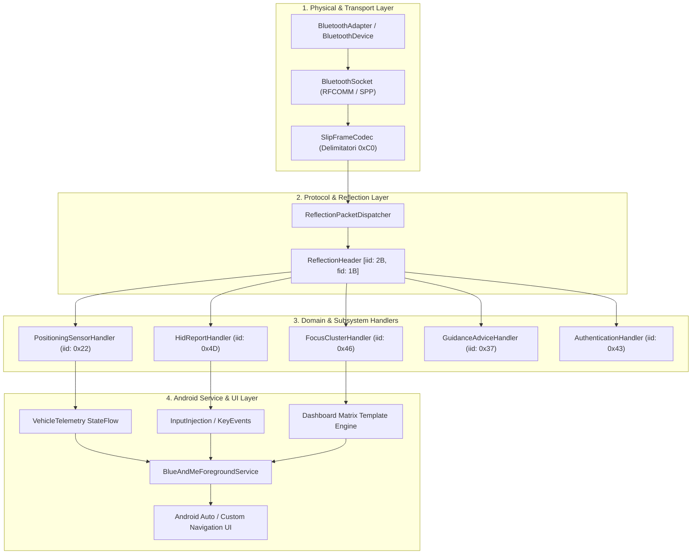

# Architettura Applicazione Android: Sostituzione TomTom Blue&Me

Questo documento definisce l'architettura software completa e il codice Kotlin pronto all'uso per realizzare l'applicazione Android sostitutiva del navigatore TomTom Blue&Me.

---

## 1. Architettura a Livelli (Clean Architecture)

L'applicazione è suddivisa in 4 layer modulari per garantire separazione delle responsabilità, testabilità e robustezza:



---

## 2. Struttura del Progetto Android

```
com.blueandme.android/
├── bluetooth/
│   ├── BluetoothConnectionState.kt
│   └── BluetoothSppManager.kt
├── protocol/
│   ├── SlipFrameCodec.kt
│   ├── ReflectionHeader.kt
│   ├── ReflectionMessage.kt
│   └── BlueAndMeConstants.kt
├── handlers/
│   ├── HidReportHandler.kt
│   ├── PositioningSensorHandler.kt
│   ├── FocusClusterHandler.kt
│   └── AuthenticationHandler.kt
├── model/
│   ├── SteeringWheelButton.kt
│   ├── VehicleTelemetry.kt
│   └── GuidanceAdvice.kt
└── service/
    └── BlueAndMeService.kt
```

---

## 3. Implementazione del Protocol Layer (Kotlin)

### 3.1 Costanti di Protocollo (`BlueAndMeConstants.kt`)

```kotlin
package com.blueandme.android.protocol

import java.util.UUID

object BlueAndMeConstants {
    // UUID standard Serial Port Profile (SPP)
    val SPP_UUID: UUID = UUID.fromString("00001101-0000-1000-8000-00805F9B34FB")

    // Nome dispositivo TomTom Blue&Me
    const val DEVICE_NAME_PREFIX = "Blue&Me"
    const val TOMTOM_DEVICE_NAME = "Blue&Me TomTom"

    // Byte speciali per framing SLIP (IOF_UART_SLIP)
    const val SLIP_END: Byte = 0xC0.toByte()
    const val SLIP_ESC: Byte = 0xDB.toByte()
    const val SLIP_ESC_END: Byte = 0xDC.toByte()
    const val SLIP_ESC_ESC: Byte = 0xDD.toByte()

    // Interface ID (IID) estratti da carlinkd
    object IID {
        const val INTERFACE_PUBLICATION: Int = 0x0001
        const val POSITIONING_SENSOR: Int = 0x0022    // Telemetria CAN-bus
        const val VEHICLE_STATUS: Int = 0x0025        // Stato quadro / batteria
        const val HMI_REMOTER: Int = 0x0032
        const val BASIC_PLANNER: Int = 0x0034
        const val NAV_OBJECT: Int = 0x0036
        const val EXTERNAL_GUIDANCE_ADVICE: Int = 0x0037 // Frecce cruscotto
        const val AUTHENTICATION: Int = 0x0043        // Handshake
        const val FEATURE: Int = 0x0044
        const val CALL_CONTROL: Int = 0x0045          // Vivavoce
        const val FOCUS: Int = 0x0046                 // Schermate e Template cruscotto
        const val LOCATION: Int = 0x0047
        const val LOCATION_CATEGORY: Int = 0x0048
        const val LOCATION_STORAGE: Int = 0x0049
        const val ROUTE: Int = 0x004A
        const val ROUTE_INSTRUCTION: Int = 0x004B
        const val HID_REPORT: Int = 0x004D            // Comandi al Volante
        const val ROUTE_CONSTRUCTOR: Int = 0x004E
        const val SETTING: Int = 0x0050
        const val THROUGHPUT_TEST: Int = 0x00FE
        const val CARLINK: Int = 0x0100
    }

    // Function ID (FID) per comandi al volante
    object FID_HID {
        const val DEVICE_AVAILABLE = 0x01
        const val DEVICE_UNAVAILABLE = 0x02
        const val REPORT = 0x03
    }

    // Function ID (FID) per telemetria veicolo
    object FID_SENSOR {
        const val SUBSCRIBE = 0x01
        const val CONFIGURATION = 0x02
        const val SENSOR_DATA = 0x03
    }

    // Function ID (FID) per cluster cruscotto
    object FID_FOCUS {
        const val INIT = 0x01
        const val REQUEST_FULL_MODE = 0x05
        const val RELEASE_FULL_MODE = 0x06
        const val SET_TEMPLATE = 0x0B
        const val SET_HOST_TEMPLATE = 0x0C
        const val SET_PROPERTY = 0x0D
        const val SET_INDEXED_PROPERTY = 0x0E
        const val RAISE_EVENT = 0x0F
        const val UPDATE_SCREEN = 0x11
    }
}
```

---

### 3.2 Codificatore e Decodificatore SLIP (`SlipFrameCodec.kt`)
Gestisce l'incapsulamento dei pacchetti seriali via SLIP framing (`0xC0`).

```kotlin
package com.blueandme.android.protocol

import java.io.ByteArrayOutputStream

class SlipFrameCodec {
    private val buffer = ByteArrayOutputStream()
    private var inEscape = false

    /**
     * Elabora un flusso di byte in ingresso ed emette frame completi.
     */
    fun feed(data: ByteArray, length: Int, onFrameReceived: (ByteArray) -> Unit) {
        for (i in 0 until length) {
            val b = data[i]
            if (inEscape) {
                when (b) {
                    BlueAndMeConstants.SLIP_ESC_END -> buffer.write(BlueAndMeConstants.SLIP_END.toInt())
                    BlueAndMeConstants.SLIP_ESC_ESC -> buffer.write(BlueAndMeConstants.SLIP_ESC.toInt())
                    else -> buffer.write(b.toInt())
                }
                inEscape = false
            } else if (b == BlueAndMeConstants.SLIP_ESC) {
                inEscape = true
            } else if (b == BlueAndMeConstants.SLIP_END) {
                if (buffer.size() > 0) {
                    onFrameReceived(buffer.toByteArray())
                    buffer.reset()
                }
            } else {
                buffer.write(b.toInt())
            }
        }
    }

    /**
     * Codifica un pacchetto Reflection in un frame SLIP pronto per l'invio via RFCOMM.
     */
    fun encode(payload: ByteArray): ByteArray {
        val out = ByteArrayOutputStream(payload.size + 8)
        out.write(BlueAndMeConstants.SLIP_END.toInt())
        for (b in payload) {
            when (b) {
                BlueAndMeConstants.SLIP_END -> {
                    out.write(BlueAndMeConstants.SLIP_ESC.toInt())
                    out.write(BlueAndMeConstants.SLIP_ESC_END.toInt())
                }
                BlueAndMeConstants.SLIP_ESC -> {
                    out.write(BlueAndMeConstants.SLIP_ESC.toInt())
                    out.write(BlueAndMeConstants.SLIP_ESC_ESC.toInt())
                }
                else -> out.write(b.toInt())
            }
        }
        out.write(BlueAndMeConstants.SLIP_END.toInt())
        return out.toByteArray()
    }
}
```

---

### 3.3 Parser Pacchetto Reflection (`ReflectionMessage.kt`)
Decodifica l'header di 3 byte (`iid` a 16-bit Little Endian e `fid` a 8-bit).

```kotlin
package com.blueandme.android.protocol

import java.nio.ByteBuffer
import java.nio.ByteOrder

data class ReflectionMessage(
    val iid: Int,          // uint16 (0..65535)
    val fid: Int,          // uint8  (0..255)
    val payload: ByteArray
) {
    companion object {
        fun parse(frame: ByteArray): ReflectionMessage? {
            if (frame.size < 3) return null

            val buffer = ByteBuffer.wrap(frame).order(ByteOrder.LITTLE_ENDIAN)
            val iid = buffer.short.toInt() and 0xFFFF
            val fid = buffer.get().toInt() and 0xFF

            val payloadLength = frame.size - 3
            val payload = ByteArray(payloadLength)
            buffer.get(payload)

            return ReflectionMessage(iid, fid, payload)
        }

        fun serialize(iid: Int, fid: Int, payload: ByteArray = ByteArray(0)): ByteArray {
            val buffer = ByteBuffer.allocate(3 + payload.size).order(ByteOrder.LITTLE_ENDIAN)
            buffer.putShort((iid and 0xFFFF).toShort())
            buffer.put((fid and 0xFF).toByte())
            buffer.put(payload)
            return buffer.array()
        }
    }
}
```

---

## 4. Subsystem Handlers

### 4.1 Comandi al Volante (`HidReportHandler.kt`)
Traduce i pacchetti `iHidReport` (`0x4D`) nei corrispondenti tasti del volante.

```kotlin
package com.blueandme.android.handlers

import android.view.KeyEvent
import com.blueandme.android.model.SteeringWheelButton
import com.blueandme.android.protocol.BlueAndMeConstants
import com.blueandme.android.protocol.ReflectionMessage
import java.nio.ByteBuffer
import java.nio.ByteOrder

class HidReportHandler(
    private val onButtonPress: (SteeringWheelButton, Int) -> Unit
) {
    fun handle(message: ReflectionMessage) {
        if (message.iid != BlueAndMeConstants.IID.HID_REPORT) return

        when (message.fid) {
            BlueAndMeConstants.FID_HID.REPORT -> {
                if (message.payload.size >= 4) {
                    val buf = ByteBuffer.wrap(message.payload).order(ByteOrder.LITTLE_ENDIAN)
                    val requestId = buf.short.toInt() and 0xFFFF
                    val rawKey = buf.short.toInt() and 0xFFFF

                    val button = when (rawKey) {
                        0x01 -> SteeringWheelButton.BACK_ESC       // Tasto ESC / Indietro
                        0x02 -> SteeringWheelButton.ARROW_UP      // Freccia Su
                        0x03 -> SteeringWheelButton.ARROW_DOWN    // Freccia Giù
                        0x04 -> SteeringWheelButton.ARROW_LEFT    // Freccia Sinistra
                        0x05 -> SteeringWheelButton.OK_ENTER      // Tasto OK / Selezione
                        0x18 -> SteeringWheelButton.PHONE         // Tasto Telefono
                        0x1A -> SteeringWheelButton.MENU_SOURCE   // Tasto Menu / Source
                        0x1D -> SteeringWheelButton.VOICE_PTT     // Comando Vocale
                        else -> SteeringWheelButton.UNKNOWN
                    }

                    val androidKeyCode = when (button) {
                        SteeringWheelButton.BACK_ESC -> KeyEvent.KEYCODE_BACK
                        SteeringWheelButton.ARROW_UP -> KeyEvent.KEYCODE_DPAD_UP
                        SteeringWheelButton.ARROW_DOWN -> KeyEvent.KEYCODE_DPAD_DOWN
                        SteeringWheelButton.ARROW_LEFT -> KeyEvent.KEYCODE_DPAD_LEFT
                        SteeringWheelButton.OK_ENTER -> KeyEvent.KEYCODE_ENTER
                        SteeringWheelButton.PHONE -> KeyEvent.KEYCODE_CALL
                        SteeringWheelButton.MENU_SOURCE -> KeyEvent.KEYCODE_MENU
                        SteeringWheelButton.VOICE_PTT -> KeyEvent.KEYCODE_VOICE_ASSIST
                        SteeringWheelButton.UNKNOWN -> KeyEvent.KEYCODE_UNKNOWN
                    }

                    onButtonPress(button, androidKeyCode)
                }
            }
        }
    }
}
```

---

### 4.2 Telemetria CAN-bus (`PositioningSensorHandler.kt`)
Elabora la velocità reale dell'auto, lo stato retromarcia e la distanza odometrica.

```kotlin
package com.blueandme.android.handlers

import com.blueandme.android.model.VehicleTelemetry
import com.blueandme.android.protocol.BlueAndMeConstants
import com.blueandme.android.protocol.ReflectionMessage
import java.nio.ByteBuffer
import java.nio.ByteOrder

class PositioningSensorHandler(
    private val onTelemetryUpdate: (VehicleTelemetry) -> Unit
) {
    fun handle(message: ReflectionMessage) {
        if (message.iid != BlueAndMeConstants.IID.POSITIONING_SENSOR) return

        when (message.fid) {
            BlueAndMeConstants.FID_SENSOR.SENSOR_DATA -> {
                if (message.payload.size >= 8) {
                    val buf = ByteBuffer.wrap(message.payload).order(ByteOrder.LITTLE_ENDIAN)
                    
                    // Struttura pacchetto SesnorData dal CAN-bus
                    val rawSpeed = buf.short.toInt() and 0xFFFF     // Velocità in 0.01 km/h o impulsi
                    val speedKmH = rawSpeed / 100.0f
                    val reverseGear = (buf.get().toInt() and 0x01) == 1 // Bit retromarcia
                    val statusFlags = buf.get().toInt() and 0xFF
                    val odometerDelta = buf.int                     // Impulsi ruota/metri

                    val telemetry = VehicleTelemetry(
                        speedKmH = speedKmH,
                        isReverseEngaged = reverseGear,
                        odometerDeltaMeters = odometerDelta,
                        timestamp = System.currentTimeMillis()
                    )

                    onTelemetryUpdate(telemetry)
                }
            }
        }
    }

    /**
     * Invia la sottoscrizione ai sensori della centralina all'avvio.
     */
    fun createSubscribePacket(): ByteArray {
        val payload = ByteBuffer.allocate(4).order(ByteOrder.LITTLE_ENDIAN)
            .putInt(100) // Intervallo aggiornamento in ms (10 Hz)
            .array()
        return ReflectionMessage.serialize(
            iid = BlueAndMeConstants.IID.POSITIONING_SENSOR,
            fid = BlueAndMeConstants.FID_SENSOR.SUBSCRIBE,
            payload = payload
        )
    }
}
```

---

## 5. Bluetooth Manager e Foreground Service

### 5.1 Manager di Connessione Bluetooth SPP (`BluetoothSppManager.kt`)

```kotlin
package com.blueandme.android.bluetooth

import android.annotation.SuppressLint
import android.bluetooth.BluetoothDevice
import android.bluetooth.BluetoothSocket
import com.blueandme.android.protocol.BlueAndMeConstants
import com.blueandme.android.protocol.ReflectionMessage
import com.blueandme.android.protocol.SlipFrameCodec
import kotlinx.coroutines.*
import java.io.InputStream
import java.io.OutputStream

class BluetoothSppManager(
    private val onMessageReceived: (ReflectionMessage) -> Unit,
    private val onConnectionChanged: (Boolean) -> Unit
) {
    private var socket: BluetoothSocket? = null
    private var inputStream: InputStream? = null
    private var outputStream: OutputStream? = null
    private val codec = SlipFrameCodec()
    private var isRunning = false
    private val scope = CoroutineScope(Dispatchers.IO + SupervisorJob())

    @SuppressLint("MissingPermission")
    fun connect(device: BluetoothDevice) {
        scope.launch {
            try {
                socket = device.createRfcommSocketToServiceRecord(BlueAndMeConstants.SPP_UUID)
                socket?.connect()
                inputStream = socket?.inputStream
                outputStream = socket?.outputStream
                isRunning = true
                onConnectionChanged(true)

                listenForIncomingData()
            } catch (e: Exception) {
                disconnect()
            }
        }
    }

    private fun listenForIncomingData() {
        val readBuffer = ByteArray(1024)
        while (isRunning) {
            try {
                val bytesRead = inputStream?.read(readBuffer) ?: -1
                if (bytesRead > 0) {
                    codec.feed(readBuffer, bytesRead) { frame ->
                        val msg = ReflectionMessage.parse(frame)
                        if (msg != null) {
                            onMessageReceived(msg)
                        }
                    }
                } else if (bytesRead == -1) {
                    break
                }
            } catch (e: Exception) {
                break
            }
        }
        disconnect()
    }

    fun send(message: ReflectionMessage) {
        scope.launch {
            try {
                val serialized = ReflectionMessage.serialize(message.iid, message.fid, message.payload)
                val encoded = codec.encode(serialized)
                outputStream?.write(encoded)
                outputStream?.flush()
            } catch (e: Exception) {
                disconnect()
            }
        }
    }

    fun disconnect() {
        isRunning = false
        try { inputStream?.close() } catch (_: Exception) {}
        try { outputStream?.close() } catch (_: Exception) {}
        try { socket?.close() } catch (_: Exception) {}
        onConnectionChanged(false)
    }
}
```

---

### 5.2 Foreground Service Android (`BlueAndMeService.kt`)

```kotlin
package com.blueandme.android.service

import android.app.Notification
import android.app.NotificationChannel
import android.app.NotificationManager
import android.app.Service
import android.content.Intent
import android.os.IBinder
import androidx.core.app.NotificationCompat
import com.blueandme.android.bluetooth.BluetoothSppManager
import com.blueandme.android.handlers.HidReportHandler
import com.blueandme.android.handlers.PositioningSensorHandler
import com.blueandme.android.model.VehicleTelemetry
import kotlinx.coroutines.flow.MutableStateFlow
import kotlinx.coroutines.flow.StateFlow

class BlueAndMeService : Service() {

    private lateinit var sppManager: BluetoothSppManager
    private lateinit var hidHandler: HidReportHandler
    private lateinit var sensorHandler: PositioningSensorHandler

    private val _telemetry = MutableStateFlow<VehicleTelemetry?>(null)
    val telemetry: StateFlow<VehicleTelemetry?> = _telemetry

    override fun onCreate() {
        super.onCreate()
        startForegroundServiceNotification()

        hidHandler = HidReportHandler { button, androidKeyCode ->
            // Broadcast intent globale per inviare l'evento a Google Maps / Android Auto
            val intent = Intent("com.blueandme.ACTION_STEERING_KEY").apply {
                putExtra("BUTTON", button.name)
                putExtra("KEYCODE", androidKeyCode)
            }
            sendBroadcast(intent)
        }

        sensorHandler = PositioningSensorHandler { data ->
            _telemetry.value = data
        }

        sppManager = BluetoothSppManager(
            onMessageReceived = { msg ->
                hidHandler.handle(msg)
                sensorHandler.handle(msg)
            },
            onConnectionChanged = { connected ->
                if (connected) {
                    // All'avvio della connessione, sottoscrivi la telemetria CAN
                    val subPacket = sensorHandler.createSubscribePacket()
                    val msg = com.blueandme.android.protocol.ReflectionMessage.parse(subPacket)
                    if (msg != null) sppManager.send(msg)
                }
            }
        )
    }

    private fun startForegroundServiceNotification() {
        val channelId = "blueandme_channel"
        val channel = NotificationChannel(channelId, "Blue&Me Connection", NotificationManager.IMPORTANCE_LOW)
        getSystemService(NotificationManager::class.java).createNotificationChannel(channel)

        val notification: Notification = NotificationCompat.Builder(this, channelId)
            .setContentTitle("Blue&Me TomTom Emulatore")
            .setContentText("Connesso alla centralina Blue&Me via Bluetooth")
            .setSmallIcon(android.R.drawable.stat_sys_data_bluetooth)
            .build()

        startForeground(101, notification)
    }

    override fun onBind(intent: Intent?): IBinder? = null
}
```

---

## 6. Permessi `AndroidManifest.xml` Richiesti

```xml
<manifest xmlns:android="http://schemas.android.com/apk/res/android">
    <!-- Bluetooth Permissions -->
    <uses-permission android:name="android.permission.BLUETOOTH" />
    <uses-permission android:name="android.permission.BLUETOOTH_ADMIN" />
    <uses-permission android:name="android.permission.BLUETOOTH_CONNECT" />
    <uses-permission android:name="android.permission.BLUETOOTH_SCAN" />
    
    <!-- Foreground Service -->
    <uses-permission android:name="android.permission.FOREGROUND_SERVICE" />
    <uses-permission android:name="android.permission.FOREGROUND_SERVICE_CONNECTED_DEVICE" />

    <application>
        <service
            android:name=".service.BlueAndMeService"
            android:foregroundServiceType="connectedDevice"
            android:exported="false" />
    </application>
</manifest>
```
