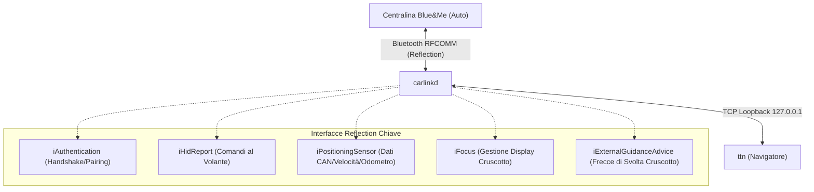

# Reverse Engineering Report: TomTom Blue&Me (`ttsystem` & `carlinkd`)

Questo documento raccoglie le evidenze tecniche e l'analisi di reverse engineering del firmware **Navcore 9.004 GO 750 Blue&Me v1**, mirata all'intercettazione del protocollo veicolare CAN-bus via Bluetooth e alla progettazione di un'applicazione Android sostitutiva.

---

## 1. Struttura del file `ttsystem` ed Estrazione del Filesystem

### 1.1 Header e Partizioni Binarie
L'analisi esadecimale e dei magic bytes di [`ttsystem`](file:///D:/RE_BlueAndMe/firmware/ttsystem) (dimensione: 7.737.905 byte, `0x761231`) evidenzia una struttura composita proprietaria TomTom:

```
+-------------------------------------------------------------------------+
| TTBL Header (12 byte) | Linux Kernel zImage ARM | Gzip initramfs (CPIO) |
| Offset: 0x000000      | Offset: 0x00000C        | Offset: 0x11EEB8      |
+-------------------------------------------------------------------------+
```

1. **Header `TTBL` (TomTom Bootloader)**:
   - Byte `0x00 - 0x03`: Magic ASCII `TTBL` (`54 54 42 4C`).
   - Byte `0x04 - 0x07`: Lunghezza sezione kernel: `0x0011EE94` (1.175.188 byte).
   - Byte `0x08 - 0x0B`: Offset/flag di caricamento.
2. **Sezione 1: Kernel Linux zImage ARM**:
   - Offset: `0x00000C` - `0x11EEB7`.
   - Magic zImage ARM a offset `0x30` (`0x24` rispetto all'inizio del kernel): `0x016F2818`.
   - Stream Gzip interno del kernel all'offset `0x0035A4`.
3. **Sezione 2: Root Filesystem integrato (initramfs)**:
   - Offset: `0x11EEB8` fino a EOF (`0x761231`).
   - Magic Gzip: `1F 8B 08`.
   - Decomprimendo questo stream si ottiene `ttsystem.blob2.bin` (14.404.096 byte).
   - Formato estratto: **Archivio CPIO New ASCII (SVR4 con CRC, magic `070701`)**.

Il filesystem è stato scompattato con successo nella directory [D:\RE_BlueAndMe\firmware\ttsystem.blob2](file:///D:/RE_BlueAndMe/firmware/ttsystem.blob2) e contiene l'albero completo: `/bin`, `/dev`, `/etc`, `/lib`, `/mnt`, `/proc`, `/sbin`, `/sys`, `/tmp`, `/var` e `/init`.

---

## 2. Demoni, Script di Configurazione e Moduli Bluetooth

### 2.1 Sequenza di Avvio del Sistema
La sequenza di boot è gestita dallo script shell [`/etc/rc`](file:///D:/RE_BlueAndMe/firmware/ttsystem.blob2/etc/rc):
1. **Loopback**: Inizializza l'interfaccia di rete loopback `lo` (`127.0.0.1`), necessaria per la comunicazione IPC locale tra `carlinkd` e `ttn`.
2. **Avvio Bluetooth**: Esegue `/etc/rc.bluetooth`:
   - Inizializza il controller Bluetooth CSR via BCSP seriale: `csrinit bcsp /dev/bt 115200`.
   - Avvia i demoni BlueZ: `hcid -f /etc/bluetooth/hcid.conf` e `sdpd`.
   - Configura i profili Bluetooth tramite `sdptool` (`hf`, `hsagw`, `a2src`, `avrct`, `avrtg`).
   - Avvia i demoni custom di connessione TomTom: `blueserver /var/run/bluesock &` e `btserver &`.
3. **Avvio Demone CarLink**:
   - Se presente `/sdcard/carlink/carlinkd`, lo copia in `/bin/carlinkd` ed esegue `carlinkd &`.
4. **Avvio Navigatore**:
   - Avvia l'applicazione principale `ttn` (`/bin/ttn`).

### 2.2 I Demoni di Comunicazione

| Demone | Percorso | Ruolo |
| :--- | :--- | :--- |
| **`carlinkd`** | [`/carlink/carlinkd`](file:///D:/RE_BlueAndMe/firmware/carlink/carlinkd) | **Gateway principale Blue&Me**. Gestisce la seriale Bluetooth RFCOMM con la centralina dell'auto e traduce i messaggi in formato Reflection verso `ttn`. |
| **`blueserver`** | `/bin/blueserver` | Gestisce l'autenticazione Bluetooth e il pairing dedicato all'auto (`CAR PAIRING ENABLE\|%s\|%s`, `DISCOVER CAR`). |
| **`btserver`** | `/bin/btserver` | Assegna e gestisce i canali virtuali seriali TTY (`/dev/rfcomm%d`, lock `/var/lock/LCK..rfcomm0`). |
| **`ttn`** | [`/bin/ttn`](file:///D:/RE_BlueAndMe/firmware/ttsystem.blob2/bin/ttn) | L'applicazione di navigazione TomTom (consumatore dei dati CAN e generatore delle indicazioni di rotta). |

---

## 3. Protocollo Proprietario "Reflection"

La comunicazione tra il TomTom e la centralina Blue&Me avviene su canale Bluetooth **RFCOMM** (denominato internamente `BSCHANNEL` o `ioframe_channel`), formattata secondo l'architettura RPC TomTom **Reflection**.

### 3.1 Struttura del Pacchetto (Reflection Framing)
Ogni pacchetto seriale inizia con un header binario validato dalla funzione `FUN_0000d6c0` di `carlinkd`:

```
+-------------------+-----------------+-----------------+------------------------+
| Message Size (4B) | iid (uint16/32) | fid (uint16/32) | Payload (variabile...) |
+-------------------+-----------------+-----------------+------------------------+
```

- **`Message Size`**: Dimensione complessiva del frame (se inferiore alla dimensione dell'header viene generato l'errore: *"Incoming message's size < Reflection header. Message rejected"*).
- **`iid` (Interface ID)**: Identifica l'interfaccia/servizio di destinazione.
- **`fid` (Function ID)**: Identifica il metodo/comando specifico invocato.
- **`Payload`**: Parametri serializzati del metodo.

### 3.2 Catalogo delle Interfacce Reflection



---

## 4. Dettaglio Funzioni: Comandi al Volante e Dati Cruscotto

### 4.1 Comandi al Volante (`iHidReport` / `CFmHidReport`)
I pulsanti fisici presenti sul volante della vettura (Fiat/Alfa Romeo/Lancia) vengono veicolati via Bluetooth alla classe `CFmHidReport`.

#### Funzione di ricezione: `CFmHidReport::OnReport` (Indirizzo: `0x0005da3c`)
La funzione decompilata tramite Ghidra rivela il dispatcher dei tasti:

```c
undefined4 FUN_0005da3c(int param_1, undefined4 param_2, undefined1 param_3, 
                        undefined4 param_4, undefined4 param_5)
{
  ...
  local_40 = param_4; // aKey
  // Log: "OnReport called (RequestId = %d, aKey = %d)"
  ...
  switch(local_40) {
  case 1:     // Tasto ESC / Indietro (Back)
  case 2:     // Tasto Freccia SU (Up)
  case 3:     // Tasto Freccia GIÙ (Down)
  case 4:     // Tasto Freccia SINISTRA (Left)
  case 5:     // Tasto OK / Invio (Enter)
  case 0x18:  // (24) Tasto Telefono / Rubrica
  case 0x1a:  // (26) Tasto Menu / Source
  case 0x1d:  // (29) Tasto Comando Vocale (Push-to-Talk)
    break;
  default:
    // Tasto non valido o non mappato
    bVar1 = false;
  }
  ...
}
```

#### Gestione Tasto ESC (`0x0005ac94`)
Quando `aKey == 1`, viene invocato il gestore specifico documentato nei log:
`"CFmHidReport::Report - ESC pressed; Issueing FocusWindowManager to lower its priority"`:
il navigatore rilascia il focus e permette al display della vettura di tornare alla schermata standard di bordo.

---

### 4.2 Dati del Cruscotto e Telemetria CAN-bus (`iPositioningSensor`)
La centralina Blue&Me interroga la linea CAN del veicolo (C-CAN / B-CAN) e pubblica i frame sul TomTom tramite l'interfaccia **`iPositioningSensor`**.

#### Metodi dell'Interfaccia `iPositioningSensor`:
1. **`Subscribe`**: Sottoscrizione da parte del navigatore alla frequenza di aggiornamento dei sensori del veicolo.
2. **`Configuration`**: Negoziazione dei sensori presenti sull'auto (sensori ruota ABS, odometro totale, stato retromarcia).
3. **`SesnorData`** *(Sensor Data)*: Pacchetto telemetrico contenente:
   - Velocità ruote istantanea (risoluzione millimetrica).
   - Stato inserimento marcia indietro (retromarcia per navigazione indoor/gallerie).
   - Incremento impulsi odometro.
4. **`iVehicleStatus`**: Stato quadro (chiave su MAR, AVV, STOP).

---

### 4.3 Display del Quadro Strumenti (`iFocus` & `Template*.fba`)
Per visualizzare menù, frecce di svolta e informazioni multimediali sul display a matrice del quadro strumenti (cluster display), il sistema utilizza:

1. **Interfaccia `iFocus`**:
   - `SetTemplate(templateId)`: Richiede l'attivazione di una determinata schermata sul cruscotto.
   - `SetHostTemplate(templateId)`: Riceve la conferma di assegnazione schermata da parte della centralina.
   - `SetProperty(propId, value)` / `SetIndexedProperty`: Popola i campi di testo e le icone sul display della macchina.
2. **File Template [`focus/*.fba`](file:///D:/RE_BlueAndMe/firmware/carlink/focus/)**:
   - Formato binario proprietario con magic **`FCS0`** (*Focus Car Screen*).
   - Esempio `Template100.fba`: Contiene la definizione del layout grafico del *"Car menu"* con i campi dinamici (*Field 1, Field 2, Field 3*).
3. **Interfaccia `iExternalGuidanceAdvice`**:
   - `StartAdvice` e `StopAdvice`: Spedisce al quadro strumenti le icone di svolta (rotatoria, svolta a dx/sx) e la distanza residua.

---

## 5. Linee Guida per l'Applicazione Android Sostitutiva

Per rimpiazzare l'hardware TomTom con uno smartphone Android, l'architettura dell'app dovrà implementare:

1. **Bluetooth Service (SPP / RFCOMM)**:
   - Emulare il nome Bluetooth (`Blue&Me TomTom`) e la classe dispositivo (`0x00` / PND) definita in `hcid.conf`.
   - Rispondere alla richiesta di discovery/pairing `CAR PAIRING ENABLE`.
2. **Parser del Protocollo Reflection**:
   - Implementare il framing `[Size: 4B][IID: 2/4B][FID: 2/4B][Payload]`.
   - Implementare `iAuthentication` per completare il challenge iniziale con la centralina.
3. **Input Receiver (`iHidReport`)**:
   - Intercettare i codici tasto (`1..5`, `0x18`, `0x1a`, `0x1d`) e mapparli sugli eventi Android (`KeyEvent.KEYCODE_DPAD_UP`, `KEYCODE_ENTER`, `KEYCODE_BACK`).
4. **Telemetry Provider (`iPositioningSensor`)**:
   - Decodificare il flusso `SesnorData` per estrarre la velocità reale CAN e lo stato di retromarcia.
